# Incident Triage Assistant

[](https://github.com/Awesomeav23/incident-triage-assistant/actions/workflows/ci.yml)

Paste a stack trace or failed CI log → get a plain-English **root cause**, a **severity**, and a
**suggested fix**, grounded in similar past incidents. Retrieval-augmented generation over
Postgres + pgvector, answered by Claude, with a React UI and an S3 → Lambda ingestion path.

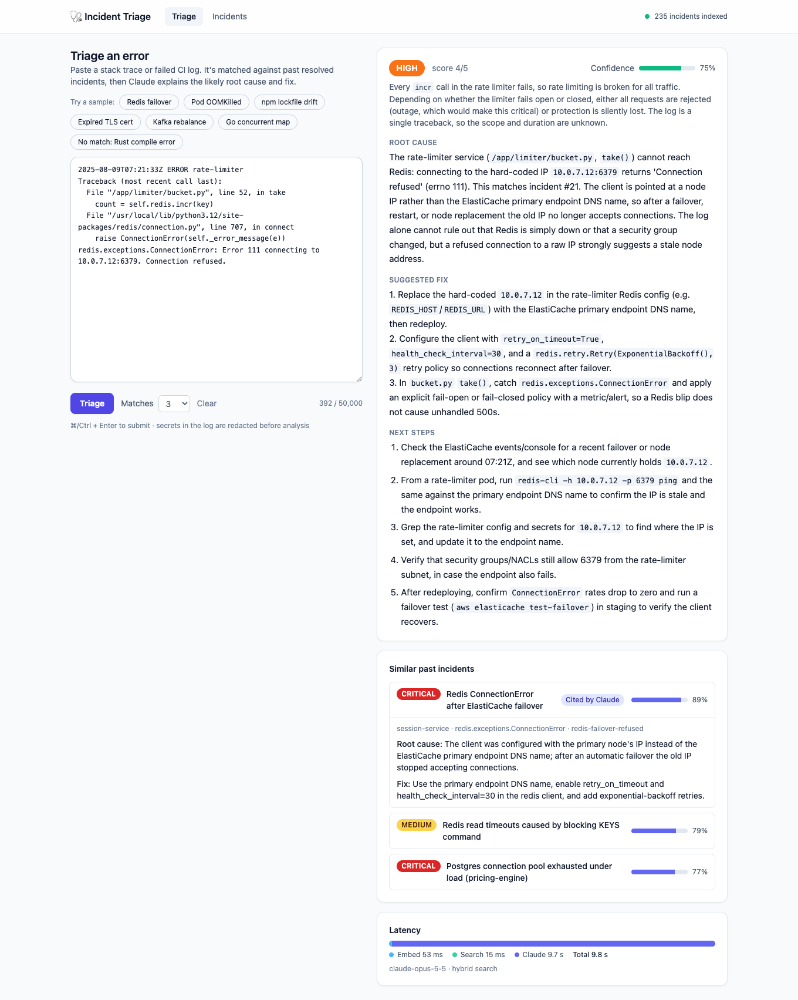
<sub>Real Claude output (Opus 5.5), captured once in Phase 4. By default the app runs in free demo mode.</sub>

## What it does

- **Triage:** redact secrets → embed the log locally → hybrid search (vector + full-text, fused with RRF) for
  similar resolved incidents → Claude writes the diagnosis as validated structured output, citing only incidents it was shown.
- **Remembers:** every triage is stored. The same failure seen again within an hour (timestamps, IDs and IPs masked)
  reuses the earlier answer without searching or calling the model.
- **Learns from feedback:** 👍 or ✏️ correct an answer; a correction can be added to the incident library so the next similar log matches it.
- **Ingests from CI:** upload a log to S3 `incoming/` → Lambda → `/triage` → `triaged/<job>.json`, with CloudWatch metrics and a critical-severity alarm.
- **Free by default:** demo mode makes no Claude calls, embeddings run locally, AWS is emulated by Moto. Nothing in tests or CI spends money.

## Screenshots

**Real Claude answers** (Opus 5.5, captured in Phase 4, before the feedback buttons and Stats page were added):

| | |
|---|---|
| 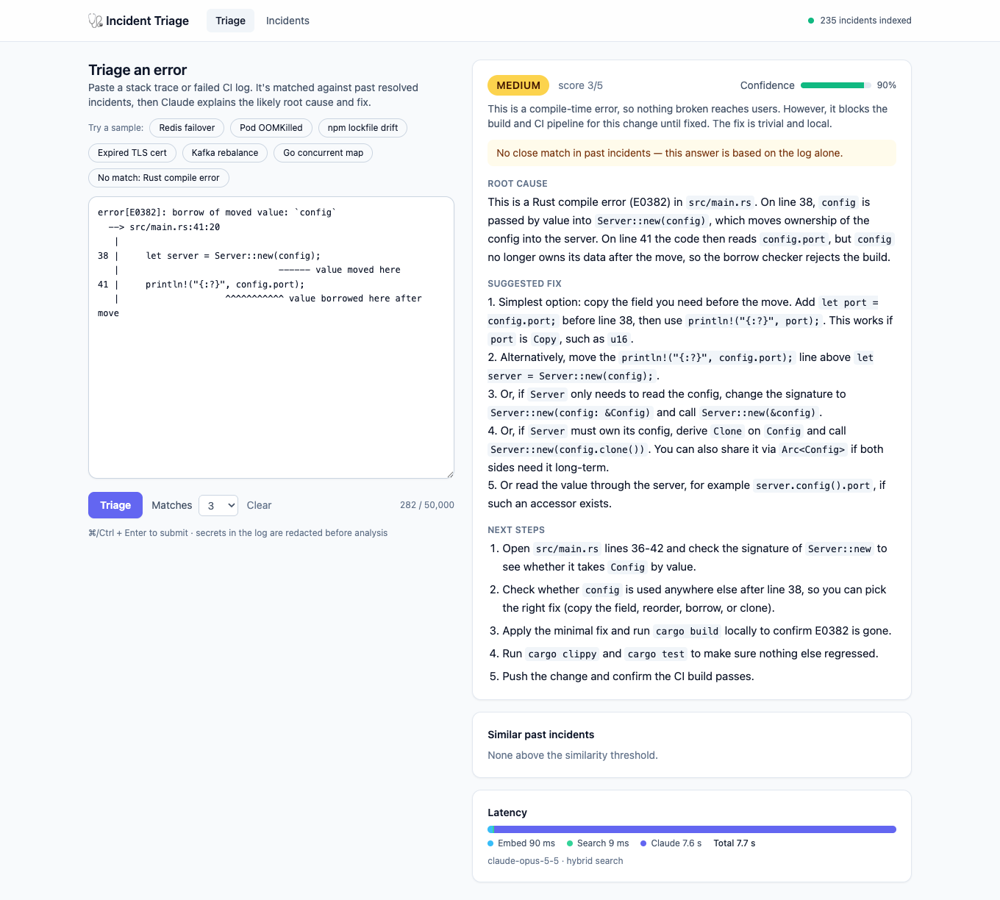 | 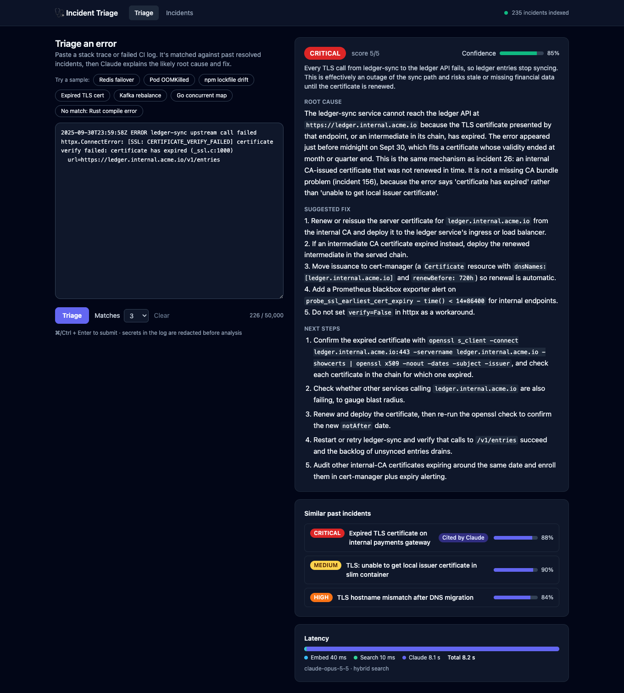 |
| A Rust compile error with no similar past incident: Claude reasons from the log alone and says so | Dark mode (follows the OS setting) |

**Current app in free demo mode** (answers copied from the closest past incident, labelled as not AI-generated):

| | |
|---|---|
| 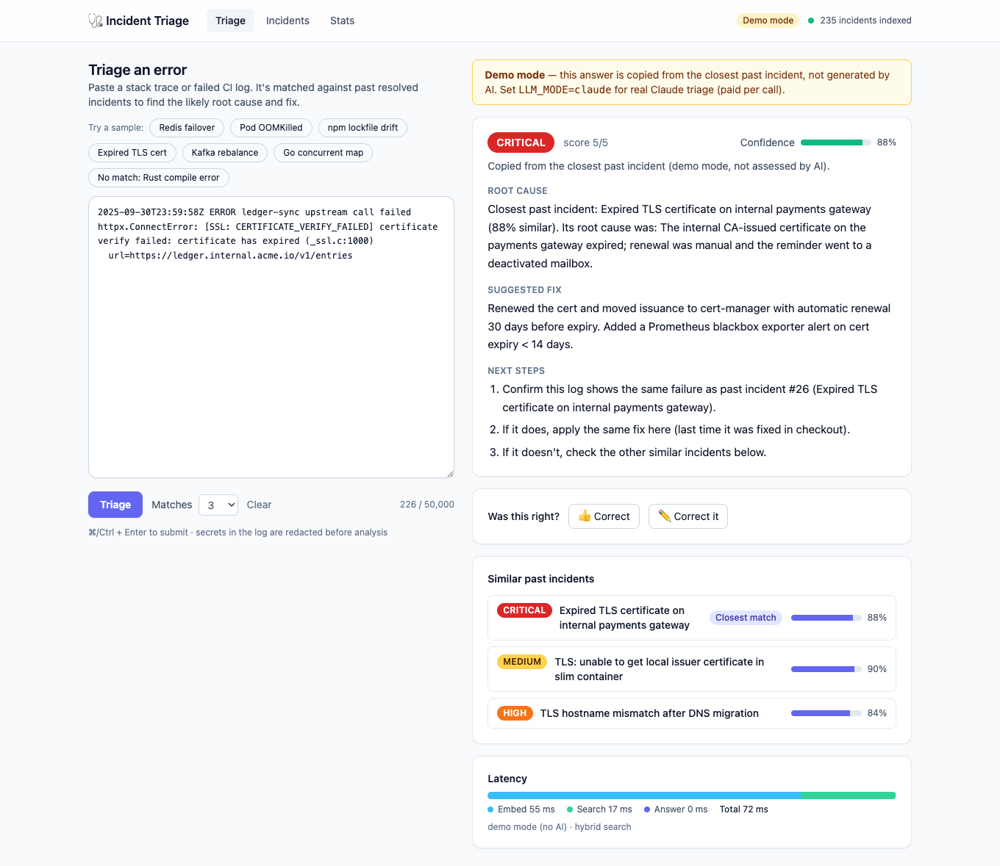 | 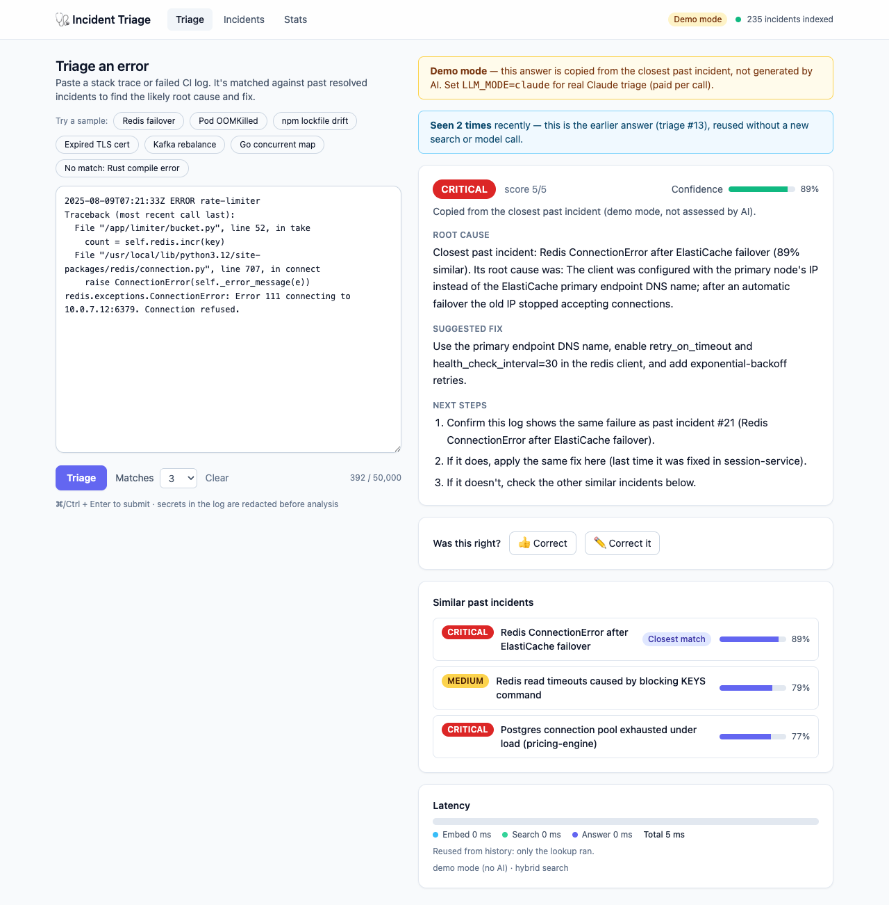 |
| Triage in demo mode: severity, root cause, fix, next steps, feedback, the 3 closest past incidents, latency | The same failure again: answered from history in a few ms, no search or model call |
| 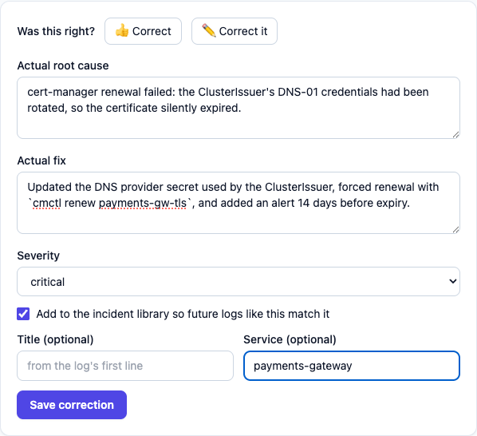 | 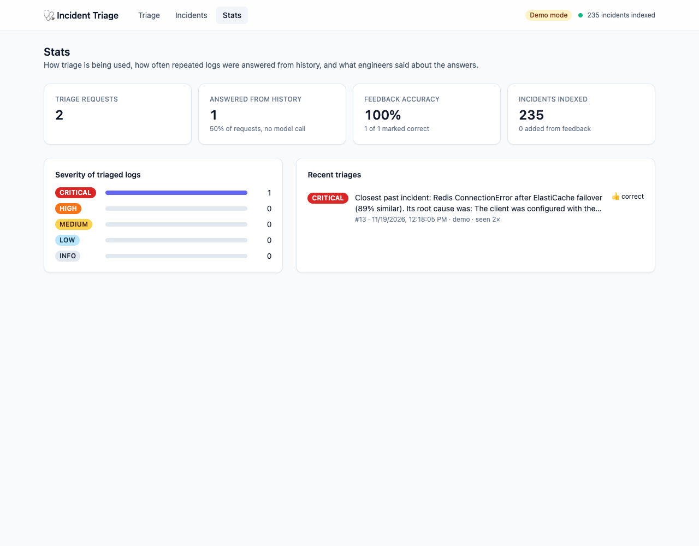 |
| ✏️ Correct it: the real root cause and fix, optionally added to the incident library | Stats: requests, answered from history, feedback accuracy, recent triages |
| 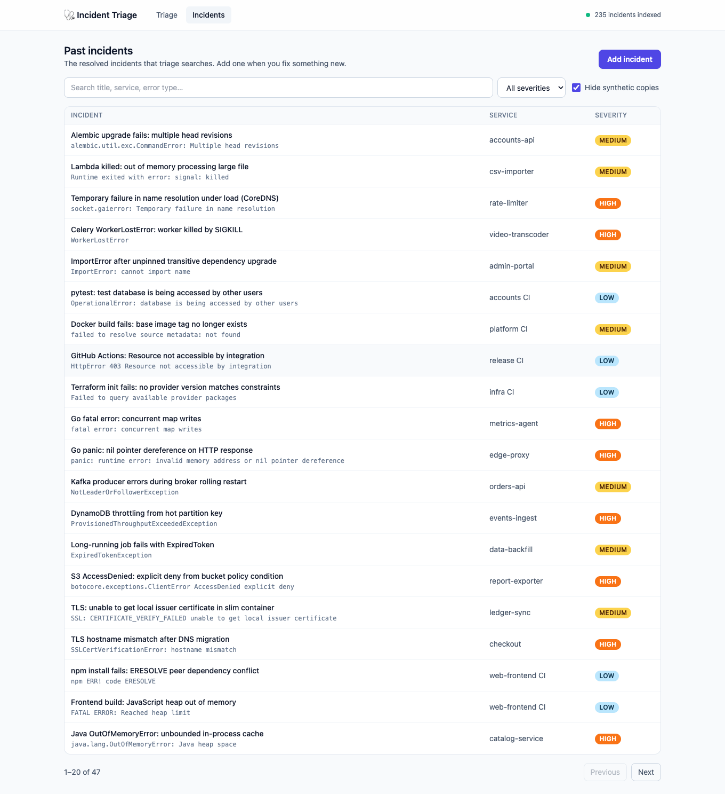 | 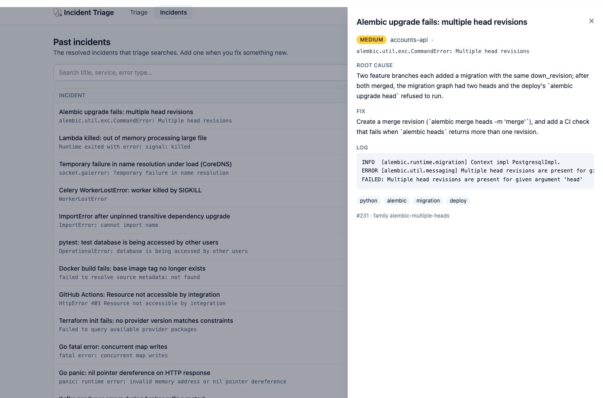 |
| Past-incident library: search, severity filter, hide synthetic copies | Incident detail: log, root cause, fix |

<p align="center">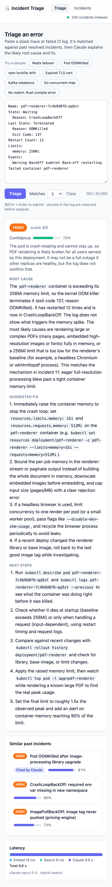<br><sub>Phone width (390 px), real Claude answer</sub></p>

**Cloud workflow** (`python -m scripts.simulate_s3_ingest --count 3 --repeat-first`, on the local AWS emulator):

```text
bucket s3://incident-triage-logs  api http://127.0.0.1:8030  emulator http://127.0.0.1:4567

  Redis failover                     triaged  s3://incident-triage-logs/triaged/ci/20261119-132924/job-1.json  severity=critical  reused from run #27
  Pod OOMKilled                      triaged  s3://incident-triage-logs/triaged/ci/20261119-132924/job-2.json  severity=high  reused from run #28
  npm lockfile drift                 triaged  s3://incident-triage-logs/triaged/ci/20261119-132924/job-3.json  severity=low  reused from run #30
  Redis failover (repeat)            triaged  s3://incident-triage-logs/triaged/ci/20261119-132924/job-4.json  severity=critical  reused from run #27

triaged/  4 object(s) from this run

failed/   0 object(s) from this run

CloudWatch metrics in IncidentTriage: DuplicateSuppressed, IngestDuplicate, IngestSucceeded, LLMLatencyMs, MatchedIncidents, SeverityScore, TriageLatencyMs
alarm critical-severity-triage: SeverityScore >= 5, state OK (Moto stores alarms but doesn't evaluate them)
```

All four were answered from history because the same samples had been triaged earlier in the session ("reused from run #…").

## Architecture

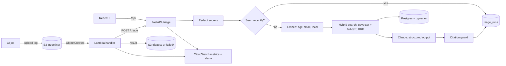

Python 3.13 (3.12 in the API image) · FastAPI · Claude API (`claude-opus-5-5`, structured outputs) · PostgreSQL 16 + pgvector ·
fastembed (BAAI/bge-small-en-v1.5) · React 18 + Vite + TypeScript + Tailwind · Docker · AWS S3 / Lambda / CloudWatch (Moto locally).
Details: [Architecture](docs/ARCHITECTURE.md) · [Decisions (ADR-001–016)](docs/DECISIONS.md).

## Results

Every number comes from a script in `scripts/` and a file in [`results/`](results/). Dataset: 235 fictional
incidents in 47 failure families; evals use 53 held-out logs that are never indexed (47 with a real match, 6 without).

**Retrieval** — `python -m scripts.eval_retrieval` → [`retrieval_2026-11-17.json`](results/retrieval_2026-11-17.json)

| Search mode | hit@1 | hit@3 | MRR | search p95 |
|---|---|---|---|---|
| Vector (pgvector cosine) | 0.894 | 0.957 | 0.928 | 8.1 ms |
| Keyword (Postgres full-text) | 0.872 | 0.957 | 0.915 | 7.3 ms |
| **Hybrid (RRF)** — default | **0.936** | **0.979** | **0.957** | **5.5 ms** |

CI fails if hybrid hit@3 drops below 0.93.

**Answer quality (demo mode)** — `python -m scripts.eval_triage` → [`triage_eval_demo_keyword_2026-11-18.json`](results/triage_eval_demo_keyword_2026-11-18.json)

| Metric | Demo mode | Target |
|---|---|---|
| Severity exact / within ±1 | 0.957 / 0.979 | ≥ 0.70 / ≥ 0.95 |
| Right past incident cited | 0.936 | ≥ 0.85 |
| Right incident shown to the model at all | 0.979 | |
| "No match" when there is none | 4 / 6 | |

Demo mode copies the closest past incident, so this is the floor a model must beat. **Claude's own answer quality
is not measured** (the project stays free); the eval, answer key and Claude-as-judge are built and tested, and a full
run is estimated at ~$2.21 (`--estimate-only` prints it; `--yes` is required to spend).

**Latency** — `python -m scripts.bench` → [`bench_2026-11-19.json`](results/bench_2026-11-19.json) (210 warm requests per path, laptop)

| Path | p50 | p95 |
|---|---|---|
| New log: redact + embed + search (demo answer) | 25 ms | 39 ms |
| Repeated log answered from history | 2.5 ms | 5.7 ms |
| Claude call (observed, Phases 3–4, not benchmarked) | 6.7–15 s per call | |

The 2 s end-to-end target holds in demo mode and for repeated logs; **with Claude it is missed**: the model call dominates.

**Noise reduction** — `python -m scripts.replay_noise` → [`replay_noise_2026-11-19.json`](results/replay_noise_2026-11-19.json)

500 logs from 12 failures (fresh timestamps, IDs, IPs) → **12 model calls, 488 avoided (97.6%)**. Best case for exact
fingerprints: logs that differ in other ways go through retrieval instead.

## Quick start

Everything runs locally and free: demo mode makes no Claude calls, and AWS is emulated by Moto.

```bash
docker compose up -d db moto                   # Postgres + pgvector :5438, AWS emulator :4567
python3.13 -m venv .venv && .venv/bin/pip install -r requirements-dev.txt
.venv/bin/python -m scripts.expand_dataset     # build 235 incidents + 53-log eval set
.venv/bin/python -m scripts.seed --reset       # index them
.venv/bin/python -m pytest                     # 141 tests, no API key or AWS account needed

cp .env.example .env                           # LLM_MODE=demo by default: free, no Claude calls
.venv/bin/uvicorn app.main:app --port 8030 --env-file .env   # API docs: http://localhost:8030/docs

cd frontend && npm install && npm run dev      # web UI: http://localhost:5181
npm test                                       # 35 frontend tests
```

- **Everything in containers:** `docker compose --profile app up -d --build` → UI :5181, API :8030
  (stop local uvicorn/Vite first, or set `API_PORT` / `WEB_PORT`). On an empty database the API container
  indexes the 235 incidents on first start (`seed --if-empty`, ~15 s), then serves.
- **Cloud workflow:** with the API running, `python -m scripts.simulate_s3_ingest` uploads sample logs to the emulated
  bucket, runs the Lambda handler on each, and lists `triaged/`, `failed/` and the CloudWatch metrics.
  For API metrics too, start the API with
  `METRICS_ENABLED=true AWS_ENDPOINT_URL=http://127.0.0.1:4567 AWS_ACCESS_KEY_ID=testing AWS_SECRET_ACCESS_KEY=testing`
  (Moto accepts any credentials; without them boto3 refuses to send and the API skips metrics with a warning).
- **Real Claude (billed per call):** set `LLM_MODE=claude` and `ANTHROPIC_API_KEY` in `.env`. Roughly 2–4 ¢ per triage with Opus.

## API

```bash
curl -s localhost:8030/triage -H 'Content-Type: application/json' \
  -d '{"log": "redis.exceptions.ConnectionError: Error 111 connecting to 10.0.7.12:6379. Connection refused."}'
```
```json
{ "root_cause_summary": "...", "severity": "critical", "severity_score": 5, "suggested_fix": "...",
  "next_steps": ["..."], "matched_incident_ids": [21], "confidence": 0.89,
  "similar_incidents": [{ "id": 21, "title": "Redis ConnectionError after ElastiCache failover", "similarity": 0.89, "...": "..." }],
  "no_close_match": false, "redacted_secrets": 0, "latency_ms": { "embed": 20, "search": 5, "llm": 0, "total": 25 },
  "model": "demo", "run_id": 42, "duplicate_of": null, "duplicate_count": 0 }
```

Also: `POST /feedback`, `GET /stats`, `GET /incidents`, `GET /incidents/{id}`, `POST /index-incident`, `GET /samples`,
`GET /health`. Contracts in [ARCHITECTURE.md §6](docs/ARCHITECTURE.md); interactive docs at `/docs`.

## Safety

- Secrets (keys, tokens, passwords, PEM blocks, URL credentials) are redacted before embedding, storage or the model.
- Logs are untrusted: they sit inside tags the log can't close, and the prompt says to ignore instructions in them.
- The model can only cite incidents it was shown (citation guard); answers marked wrong are never reused.
- Paid calls need an explicit switch: `LLM_MODE=claude` for the app, `RUN_LIVE=1` for the live test, `--yes` for the eval.

## Limitations

- Claude's answer quality and latency aren't benchmarked here (cost); the 2 s target is missed with Claude (~7–15 s per call).
- The dataset is fictional and small (47 failure families); real incident history would need re-tuning (`MIN_SIMILARITY`, see ADR-004b).
- "No match" detection is imperfect: similarity ranges overlap, so 2 of 6 no-match logs still get a (weak) match shown.
- Duplicate reuse is exact-fingerprint only; near-duplicates go through search instead.
- AWS runs on Moto: the alarm is stored but not evaluated, and the Lambda is invoked by a script, not by a real S3 notification.
  The code is the same for real AWS; deploying it is an optional extra.
- Secret redaction is regex-based and best-effort.

## Docs

[Requirements](docs/REQUIREMENTS.md) · [Architecture](docs/ARCHITECTURE.md) · [Decisions](docs/DECISIONS.md) ·
[Implementation plan](docs/IMPLEMENTATION_PLAN.md) · [Eval plan](docs/EVAL_PLAN.md) · [Roadmap](ROADMAP.md)
